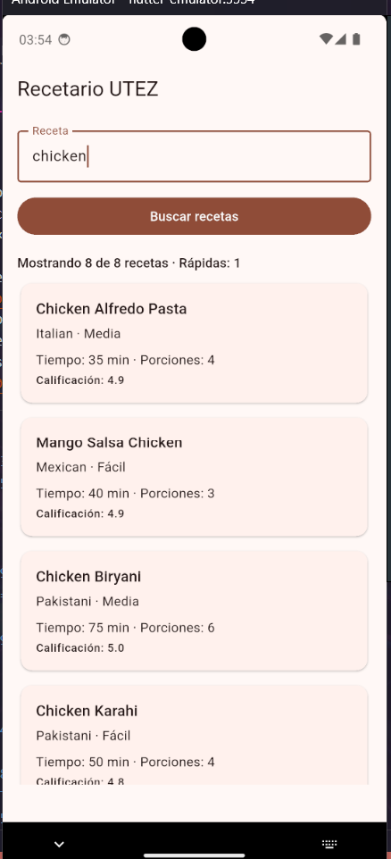
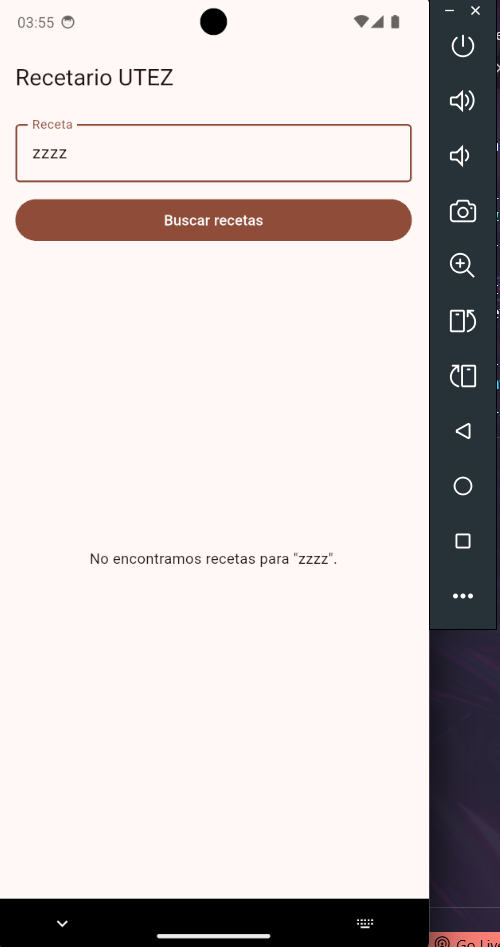
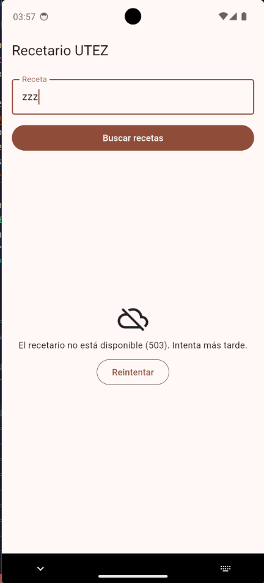
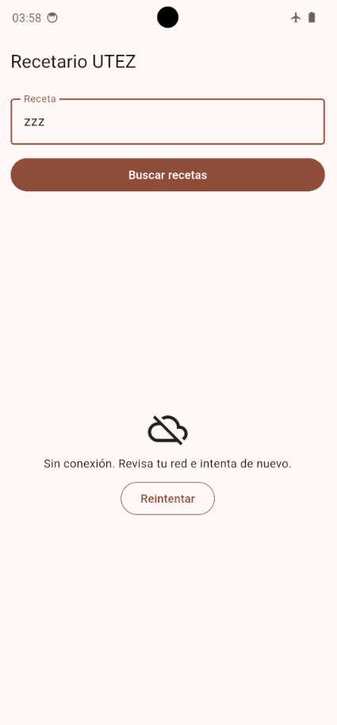
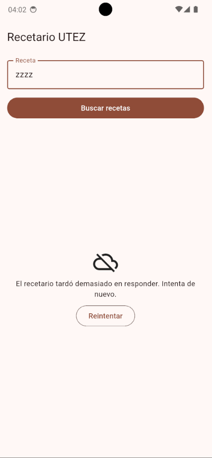

# Evidencias — Recetario UTEZ

**Nombre:** Alan Yahir Canchola Aguilar
**Matrícula:** 20233TN135
**Fecha:** 03-10-2026
**Dispositivo donde se probó:** emulador Android

## 1. Del JSON a Dart

| JSON | Campo Dart | Tipo | Regla (obligatorio, tolerado, valor por defecto) |
|---|---|---|---|
| `id` | `Receta.id` | `int` | Obligatorio: si falta o no es entero, `RespuestaInvalida`. |
| `name` | `Receta.nombre` | `String` | Obligatorio. |
| `cuisine` | `Receta.cocina` | `String` | Obligatorio. |
| `difficulty` | `Receta.dificultad` | `Dificultad` (enum) | Tolerado: `Easy`/`Medium`/`Hard` se traducen; cualquier otro valor, o si falta, es `Dificultad.desconocida` («Sin dato»). |
| `prepTimeMinutes` | `Receta.minutosPreparacion` | `int` | Obligatorio. |
| `cookTimeMinutes` | `Receta.minutosCoccion` | `int` | Obligatorio. |
| `servings` | `Receta.porciones` | `int` | Obligatorio. |
| `rating` | `Receta.calificacion` | `double` | Obligatorio; se lee como `num` y se convierte con `.toDouble()` porque llega como `5` o como `4.6`. |
| `tags` | `Receta.etiquetas` | `List<String>` | Tolerado: si falta o es `null`, lista vacía; si no es lista de textos, `RespuestaInvalida`. |
| `ingredients` | `Receta.ingredientes` | `List<String>` | Tolerado: igual que `tags`. |
| `recipes` | `PaginaRecetas.recetas` | `List<Receta>` | Obligatorio; `[]` es válido (búsqueda sin resultados). |
| `total` | `PaginaRecetas.total` | `int` | Obligatorio. |
| (calculado) | `Receta.tiempoTotal` / `esRapida` | `int` / `bool` | No viene del JSON: preparación + cocción; rápida si es ≤ 30 min. |

Campos del JSON que la app ignora: `image`, `instructions`, `caloriesPerServing`, `userId`, `mealType`, `reviewCount`, etc.

## 2. Escenarios probados con el servicio real

| Escenario | Cómo lo provoqué | Qué vio la persona | Línea de la bitácora | Captura | Prueba del kit que lo cubre |
|---|---|---|---|---|---|
| Éxito | Escribí `chicken` y toqué **Buscar recetas**. | Botón desactivado con indicador de carga y después tarjetas de recetas, con el encabezado «Mostrando N de M recetas · Rápidas: K». | `← 200 GET /recipes/search (1405 ms)` |  | etapa3: «200 → PaginaRecetas»; etapa4: «Inicial → Cargando → Listas, con exactamente dos avisos»; etapa5: «texto + botón → indicador y botón apagado → tarjetas». |
| Vacío | Busqué `zzzz`. | El mensaje «No encontramos recetas para "zzzz".», sin botón Reintentar. | `← 200 GET /recipes/search (1098 ms)` |  | etapa3: «200 sin resultados → página vacía»; etapa4: «sin resultados → Vacias, recordando qué se buscó»; etapa5: «vacío con texto dice qué se buscó…». |
| Error del servidor | Cambio temporal A en `main.dart`: un interceptor que cambia la ruta a `/http/503`, para que DummyJSON responda 503. | «El recetario no está disponible (503). Intenta más tarde.» y botón **Reintentar**. | `✗ badResponse 503 GET /http/503 (1470 ms)` |  | etapa3: «503 → ErrorDelServidor(503)»; etapa4: «FallaRed → Fallidas con el mensaje de mensajePara»; etapa5: «error → mensaje y Reintentar…». |
| Sin red | Activé el modo avión en el emulador y busqué `pasta`. | «Sin conexión. Revisa tu red e intenta de nuevo.» y botón **Reintentar**. | `✗ connectionError GET /recipes/search (76 ms)` |  | etapa3: «sin red → SinConexion»; etapa4: «mensajePara: un texto claro por falla…»; etapa5: «error → mensaje y Reintentar…» (usa `SinConexion`). |
| Tiempo agotado | Cambio temporal B: `delay=5000` en la query y timeouts de 2 s. | «El recetario tardó demasiado en responder. Intenta de nuevo.» y botón **Reintentar**. | `✗ receiveTimeout GET /recipes/search (3452 ms)` |  | etapa3: «receiveTimeout → TiempoAgotado» y «connectTimeout → TiempoAgotado»; etapa4: «mensajePara…». |

## 3. Preguntas de reflexión

1. **¿En qué se diferencian el escenario «Error del servidor» y «Sin red» desde el punto de vista de HTTP?**  
   En «Error del servidor» la comunicación HTTP se completó; el servidor recibió la petición y respondió con un código 5xx (ej. 503). En «Sin red» la petición nunca salió del dispositivo ni llegó a ningún servidor, por lo que no existe código de estado ni respuesta HTTP.

2. **¿Por qué «Vacío» no es un error?**  
   Porque la transacción HTTP fue exitosa (código 200 OK). La API procesó la consulta correctamente y devolvió un resultado válido, pero sin coincidencias (`"recipes": []`). Es un estado de datos normal, no un fallo técnico.

3. **La búsqueda de la persona viaja en la query. ¿Por qué tu bitácora no la escribe?**  
   Por privacidad y seguridad. El interceptor solo registra el método y la ruta (`options.path`) para no exponer datos de la persona o búsquedas sensibles en los registros de depuración.

4. **Si DummyJSON cambiara `rating` por `score`, ¿qué archivos tendría que modificar y por qué solo esos?**  
   Únicamente `lib/datos/recetas_json.dart`. Gracias a la separación por capas, es el único archivo que traduce la estructura del JSON hacia el modelo de Dart; la capa de dominio y las vistas siguen usando la propiedad interna `calificacion` sin verse afectadas.